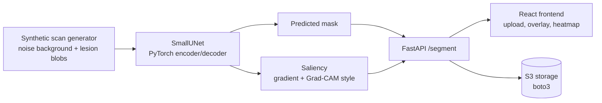

# NeuroScribe

**An end-to-end medical-imaging-style segmentation pipeline in PyTorch, from synthetic data generation to a U-Net model, interpretability heatmaps, a FastAPI service and a React frontend.**

    

🎥 **[Watch the video demo](https://drive.google.com/file/d/1030bPW-F35IiUdXPA8f-A33M34ywdRkG/view?usp=sharing)**

> **Not a medical device.** Every image here is procedurally generated synthetic data. No real patient data or real MRI/CT scans are used anywhere in this project, and it must never be used for medical decisions.

---

## Results

Measured on a held-out synthetic test set of **500 images** (64×64, fixed seed) after the default 20 epoch training run. Reproduce with `python3 train.py && python3 evaluate.py`.

| Method | Dice | IoU | Precision | Recall |
|---|---|---|---|---|
| **SmallUNet** (threshold 0.5) | **0.890** | **0.807** | 0.867 | 0.917 |
| Intensity threshold baseline (best global threshold) | 0.550 | 0.405 | 0.606 | 0.595 |

- The U-Net beats the strongest simple baseline by **+0.34 Dice**, even though that baseline's threshold was tuned on the test set itself.
- **~5 ms** CPU inference per image, and full training takes about **70 seconds on a CPU**, no GPU needed.
- Training loss (BCE + Dice) drops from about 1.43 to 0.33 over 20 epochs.

Numbers vary slightly between runs because training batches are randomly generated.

---

## How it works



| Component | File | What it does |
|---|---|---|
| Data generator | `backend/app/data.py` | Builds 2D scan-like images (smooth noise "tissue" plus 1 to 3 bright lesion-like blobs) with matching ground-truth masks |
| Model | `backend/app/model.py` | `SmallUNet`, a 3-level U-Net with skip connections in plain PyTorch, trained with combined BCE + Dice loss |
| Interpretability | `backend/app/interpretability.py` | Vanilla input-gradient saliency and a Grad-CAM-style map that hooks the bottleneck layer |
| API | `backend/app/main.py` | `GET /health` and `POST /segment`, which return the mask, overlay and heatmap as base64 PNGs |
| Storage | `backend/app/storage.py` | S3-backed `StorageClient` via boto3, tested against moto's in-memory AWS mock |
| Training | `backend/train.py` | Trains on freshly generated batches and saves weights |
| Evaluation | `backend/evaluate.py` | Scores the model on a fixed held-out set against a baseline and times inference |
| Frontend | `frontend/index.html` | Single-file React 18 app with no build step |

---

## Quickstart

```bash
cd backend
python3 -m venv .venv && source .venv/bin/activate
pip install -r requirements.txt

python3 train.py       # ~70 s on CPU, saves app/weights/unet_synthetic.pt
python3 evaluate.py    # prints the results table above
uvicorn app.main:app --reload
```

Then open `frontend/index.html` in a browser. It talks to `http://localhost:8000` by default.

If no trained weights exist, the API trains a quick model on startup so a fresh clone works out of the box.

### Docker

```bash
cd backend
docker build -t neuroscribe .
docker run --rm -p 8000:8000 neuroscribe
```

---

## Testing

```bash
cd backend
pytest    # 13 tests
```

- **Model.** Output shapes, Dice loss sanity checks, and a learning test that asserts loss actually decreases over training.
- **API.** Full `/segment` round trip on a real PNG, both saliency methods, and error handling for bad input.
- **Storage.** Upload, download, listing and deletion against a mocked S3 bucket.

---

## Design decisions and limitations

- **2D instead of 3D.** A slice-based model keeps the whole pipeline trainable in about a minute on a laptop CPU while still using a real encoder/decoder architecture.
- **Synthetic data only.** This keeps the project free of privacy concerns, but it also means these results measure performance on synthetic data from the same distribution. They say nothing about accuracy on real scans.
- **Gradient-based interpretability.** The heatmaps use input gradients and a Grad-CAM-style approximation. These show which pixels most influence the prediction, not a full feature attribution method like SHAP.

### Possible next steps

- Train and evaluate on a public dataset such as the Medical Segmentation Decathlon
- Add data augmentation and a validation-based early stopping loop
- Export the model to ONNX for faster serving

---

## License

MIT. See [LICENSE](LICENSE).
